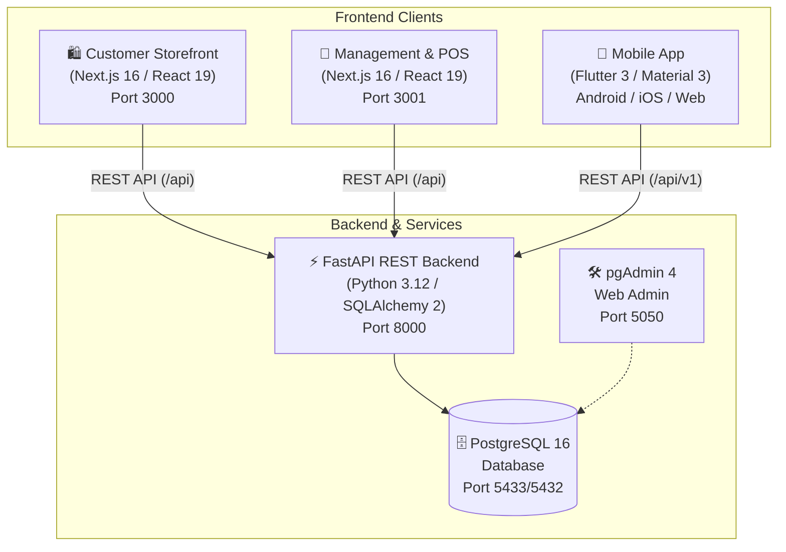

# 🐼 Blue Panda E-Commerce Platform

[](https://fastapi.tiangolo.com/)
[](https://www.python.org/)
[](https://nextjs.org/)
[](https://react.dev/)
[](https://www.typescriptlang.org/)
[](https://flutter.dev/)
[](https://www.postgresql.org/)
[](https://www.docker.com/)
[](./docs/deployment/PRODUCTION_READINESS_REPORT.md)
[](LICENSE)

**Blue Panda** is a modern, full-stack, multi-client e-commerce marketplace platform. Built as a clean monorepo, it features a high-performance **FastAPI** REST backend, decoupled **Next.js 16** customer storefront and administrative management portals, and a cross-platform **Flutter** customer mobile application.

---

## 📑 Table of Contents

- [System Architecture](#-system-architecture)
- [Applications & Services](#-applications--services)
- [Core Features](#-core-features)
  - [🛍️ Customer Storefront](#-customer-storefront-storefront)
  - [🏢 Management Portal & POS](#-management-portal--pos-management)
  - [📱 Mobile Application](#-mobile-application-mobile-app)
  - [⚡ REST API Backend](#-rest-api-backend-backend)
- [Quick Start with Docker](#-quick-start-with-docker)
- [Individual Service Setup](#-individual-service-setup-local-development)
  - [1. Backend API](#1-backend-api-backend)
  - [2. Customer Storefront](#2-customer-storefront-storefront)
  - [3. Management Portal](#3-management-portal-management)
  - [4. Mobile App](#4-mobile-app-mobile-app)
- [Default Ports & Access Endpoints](#-default-ports--access-endpoints)
- [Testing & Quality Assurance](#-testing--quality-assurance)
- [Security & Production Readiness Notice](#-security--production-readiness-notice)
- [Project Structure](#-project-structure)
- [Documentation Hub](#-documentation-hub)
- [License](#-license)

---

## 🏛 System Architecture

The platform uses a decoupled, service-oriented architecture where customer storefront, administrative operations, and mobile experiences consume a unified REST API backend:



---

## 📦 Applications & Services

| Directory | Stack | Purpose | Default Port / URL |
| :--- | :--- | :--- | :--- |
| **`storefront/`** | Next.js 16, React 19, Tailwind CSS v4, Zustand | Customer shopping website | [`http://localhost:3000`](http://localhost:3000) |
| **`management/`** | Next.js 16, React 19, Tailwind CSS v4 | Admin dashboard, POS terminal, Seller Center | [`http://localhost:3001`](http://localhost:3001) |
| **`backend/`** | FastAPI, SQLAlchemy 2, Pydantic 2, PostgreSQL | Core REST API and business logic | [`http://localhost:8000`](http://localhost:8000) |
| **`mobile-app/`** | Flutter 3, Dart 3, Material 3, Provider | Customer mobile application | Emulator / Device |
| **`deploy/`** | Docker Compose, Caddy, Shell | Production configs & operational scripts | Host-configured |
| **`web-app/`** | Next.js 16 | Legacy combined web application | Separate run only |

---

## ✨ Core Features

### 🛍️ Customer Storefront (`storefront/`)
- **Product Discovery & Filtering:** Dynamic catalog browsing with multi-criteria filtering (category, price range, ratings, in-stock status) and responsive sorting.
- **Instant Search Dialog:** Command palette modal (`Cmd+K` / click) with real-time product search and quick navigation.
- **Quick View Modal:** Product preview overlay allowing customers to inspect details, select variants, and add to cart without navigating away.
- **Cart & Wishlist:** Flyout cart drawer, detailed cart page (`/cart`), free-shipping threshold indicator, and persistent Zustand store syncing to backend upon sign-in.
- **Checkout & Orders:** Multi-step Cash on Delivery (COD) checkout, server-validated coupon discounts, delivery address management, and live order tracking (`/orders`).
- **Session Isolation:** Independent storage keys preventing customer sessions from colliding with administrative accounts on shared machines.

### 🏢 Management Portal & POS (`management/`)
- **Executive KPI Dashboard:** Real-time metrics for store revenue, order volume, pending fulfillment, out-of-stock items, and recent activity timelines.
- **Catalog & Inventory Administration:** Comprehensive CRUD for products, categories, visual asset URLs, and real-time inventory level adjustments.
- **Point of Sale (POS) Terminal:** High-speed cashier interface with instant product search, parked cart suspension/resumption, cash and card split calculations, and thermal receipt printing (both **80mm** and **58mm** formats).
- **Multi-Tenant Seller Center (`/seller`):** Isolated merchant portal for registered sellers to monitor their store performance, update business profiles, and manage their own products.
- **Customer & Review Moderation:** Customer profile inspection, purchase verification, and review moderation workflows.

### 📱 Mobile Application (`mobile-app/`)
- **Material 3 Design:** Beautiful mobile experience with custom typography (Plus Jakarta Sans) and persistent light/dark theme support.
- **Shimmer Loading & Lazy Loading:** Smooth skeleton placeholders while fetching data and infinite scroll pagination for product lists.
- **Product Details & Ratings:** Hero transition animations, quantity steppers, interactive 5★→1★ customer rating breakdown, and bottom-sheet review submissions.
- **In-App Notification Hub:** Unread badge tracking, category filters, mark as read, and persistent "Clear All" notification support.
- **Reliable Offline Behavior:** Friendly connectivity recovery screen with retry actions when the API is unreachable (no fake products shown).

### ⚡ REST API Backend (`backend/`)
- **FastAPI Framework:** Synchronous SQLAlchemy 2 sessions, Alembic migration tracking, and Pydantic 2 schema validation.
- **Dual Routing:** Compatible API prefixes at both `/api` (used by web apps) and `/api/v1` (used by mobile endpoints).
- **Authentication & RBAC:** Secure bcrypt password hashing, signed JWT bearer tokens, NIST-compliant password strength enforcement, and server-side role validation for `admin`, `seller`, and `customer`.
- **Interactive Documentation:** Built-in Swagger UI at [`/docs`](http://localhost:8000/docs) and ReDoc at [`/redoc`](http://localhost:8000/redoc).
- **Admin CLI Utility:** Secure command-line tool (`backend/scripts/create_admin.py`) for creating or promoting administrator accounts without hardcoding credentials.

---

## 🚀 Quick Start with Docker

The fastest way to spin up the complete Blue Panda ecosystem is using Docker Compose:

### Prerequisites
- [Docker Desktop](https://www.docker.com/) (or Docker Engine + Docker Compose)
- Git

### 1. Clone the repository
```bash
git clone https://github.com/Bunvathana876/e_commerce_techStore.git
cd e_commerce_techStore
```

### 2. Configure environment variables
Copy the root `.env.example` file to `.env`:
```bash
cp .env.example .env
```
*(Review `.env` to configure ports or credentials. Keep production secrets out of version control.)*

### 3. Launch all services
Use the one-click launcher script:
```bash
chmod +x run.sh
./run.sh
```
Or use Docker Compose directly:
```bash
docker compose up --build -d
```

> **Note on Bundled PostgreSQL:** By default, Docker Compose connects to the database specified in your `DATABASE_URL`. To start the bundled PostgreSQL 16 container, enable the `container-db` profile:
> ```bash
> docker compose --profile container-db up --build -d
> ```

---

## 💻 Individual Service Setup (Local Development)

If you prefer to run services individually without Docker:

### 1. Backend API (`backend/`)

**Prerequisites:** Python 3.12+, PostgreSQL running locally.

```bash
cd backend

# Create and activate virtual environment
python3 -m venv .venv
source .venv/bin/activate  # On Windows: .venv\Scripts\activate

# Install dependencies
pip install -r requirements.txt

# Configure environment
cp .env.example .env
# Edit .env to set your DATABASE_URL and JWT_SECRET_KEY

# Run database migrations
alembic upgrade head

# (Optional) Provision an initial administrator account
python3 -m scripts.create_admin --email admin@example.com --name "System Admin"

# Start FastAPI development server
uvicorn app.main:app --reload --host 0.0.0.0 --port 8000
```
Backend API will be accessible at `http://localhost:8000` (OpenAPI Docs: `http://localhost:8000/docs`).

---

### 2. Customer Storefront (`storefront/`)

**Prerequisites:** Node.js 20+, npm 10+.

```bash
cd storefront

# Install dependencies
npm install

# Configure environment
cp .env.example .env.local

# Start Next.js development server
npm run dev
```
Customer Storefront will be accessible at `http://localhost:3000`.

---

### 3. Management Portal (`management/`)

**Prerequisites:** Node.js 20+, npm 10+.

```bash
cd management

# Install dependencies
npm install

# Configure environment
cp .env.example .env.local

# Start Next.js development server
npm run dev
```
Management Portal will be accessible at `http://localhost:3001`.

---

### 4. Mobile App (`mobile-app/`)

**Prerequisites:** Flutter SDK 3.11+, Dart 3+, Android Studio or Xcode.

```bash
cd mobile-app

# Install Flutter dependencies
flutter pub get

# Run on connected emulator or device
flutter run
```

To target a custom backend IP (e.g. for Android emulator or physical device on LAN):
```bash
# Android Emulator (default points to host machine loopback)
flutter run --dart-define=API_URL=http://10.0.2.2:8000

# Physical device on the same local network
flutter run --dart-define=API_URL=http://192.168.1.X:8000
```
*(Do not append `/api` to the mobile `API_URL`; mobile routes include `/api/v1` internally.)*

---

## 🌐 Default Ports & Access Endpoints

| Service | Address | Description |
| :--- | :--- | :--- |
| **Customer Storefront** | [`http://localhost:3000`](http://localhost:3000) | Public customer shopping experience |
| **Management Portal** | [`http://localhost:3001`](http://localhost:3001) | Admin Dashboard, POS, and Seller Center |
| **FastAPI REST Backend** | [`http://localhost:8000`](http://localhost:8000) | Core REST API server |
| **Interactive API Docs** | [`http://localhost:8000/docs`](http://localhost:8000/docs) | Swagger UI interactive documentation |
| **Alternative API Docs** | [`http://localhost:8000/redoc`](http://localhost:8000/redoc) | ReDoc API specifications |
| **Backend Healthcheck** | [`http://localhost:8000/health`](http://localhost:8000/health) | Liveness & service health endpoint |
| **PostgreSQL Database** | `localhost:5433` (Docker: 5432) | Relational database (when using Compose) |
| **pgAdmin 4** | [`http://localhost:5050`](http://localhost:5050) | Web-based database management UI |

---

## 🧪 Testing & Quality Assurance

The repository includes a comprehensive, automated test suite across all services:

| Suite | Scope & Coverage | Command | Result |
| :--- | :--- | :--- | :--- |
| **Backend** | Auth, RBAC, orders, stock locking, reviews, admin CLI | `cd backend && pytest -q` | **789 passing** |
| **Storefront** | Session isolation, checkout security, filter logic | `cd storefront && npm test` | **91 passing** |
| **Management** | Role routing, POS calculations, seller store rules | `cd management && npm test` | **95 passing** |
| **Mobile App** | State providers, offline recovery, validators, widgets | `cd mobile-app && flutter test` | **204 passing** |
| **Code Linting** | Static analysis across all projects | `npm run lint` / `flutter analyze` | **Clean (0 errors)** |

---

## 🔒 Security & Production Readiness Notice

In accordance with our platform security guidelines:
- **Cash on Delivery (COD)** is the supported checkout and settlement path. Card, KHQR, and digital wallet options presented in the UI are demo simulations and should not be treated as connected payment gateways.
- **In-App Notifications** are stored in PostgreSQL and fetched via polling; they are not mobile push notifications (APNs/FCM).
- **Order Tracking** reflects database status milestones (`pending` → `processing` → `delivered`); external carrier API tracking is not yet integrated.
- **Never Commit Secrets:** Real `.env` files, production JWT secrets, and SSL certificates are strictly excluded via `.gitignore`. Always use `.env.example` templates for configuration.
- **Production Deployments:** Refer to [`deploy/production/`](deploy/production/) for Caddy reverse proxy configurations with automatic TLS, non-root user execution, and hardened networking.

---

## 📁 Project Structure

```text
e-commerce/
├── backend/                  # FastAPI REST API, SQLAlchemy models & migrations
│   ├── alembic/              # Database migration versions
│   ├── app/                  # Main application package
│   │   ├── api/v1/routes/    # API endpoints (auth, products, orders, etc.)
│   │   ├── core/             # Security, config, dependencies, password policy
│   │   ├── db/               # Database engine, session, and seed data
│   │   ├── models/           # SQLAlchemy 2 data models
│   │   ├── schemas/          # Pydantic 2 validation schemas
│   │   └── services/         # Business logic layer
│   ├── scripts/              # CLI scripts (create_admin.py)
│   ├── tests/                # Automated pytest test suites
│   ├── Dockerfile            # Container definition for backend
│   └── requirements.txt      # Python dependencies
├── storefront/               # Customer shopping web application (Next.js 16)
│   ├── src/app/              # Next.js App Router (shop, cart, checkout, orders)
│   ├── src/components/       # UI components (cards, quick-view, search dialog)
│   ├── src/lib/              # State store (Zustand), API client, auth helpers
│   └── Dockerfile            # Container definition for storefront
├── management/               # Admin portal, POS, and Seller Center (Next.js 16)
│   ├── src/app/              # Next.js App Router (admin dashboard, pos, seller)
│   ├── src/components/       # Admin sidebar, POS thermal receipt, seller views
│   ├── src/lib/              # Admin auth, session manager, API client
│   └── Dockerfile            # Container definition for management
├── mobile-app/               # Flutter mobile application
│   ├── lib/                  # Flutter application code
│   │   ├── app/              # Routes and MaterialApp setup
│   │   ├── core/             # API client, theme, network exceptions, constants
│   │   ├── features/         # Feature modules (auth, home, products, cart, etc.)
│   │   └── shared/           # Reusable widgets (buttons, banners, nav bar)
│   └── test/                 # Flutter unit & widget tests
├── deploy/                   # Production configurations & operational runbooks
│   ├── production/           # Caddy, production Docker Compose & security rules
│   └── scripts/              # backup-postgres.sh, restore-drill.sh, migrate-approved.sh
├── docs/                     # Centralized documentation knowledge base
│   ├── architecture/         # System designs, multi-vendor marketplace plans
│   ├── database-and-backend/ # Seeding procedures, admin bootstrap plans
│   ├── deployment/           # VPS deployment runbooks & hardening reports
│   └── planning/             # Frontend separation & security audits
├── pgadmin/                  # pgAdmin 4 server configuration
├── .env.example              # Monorepo environment variables template
├── .gitignore                # Root Git ignore rules (secrets, build outputs)
├── docker-compose.yml        # Development multi-container orchestration
└── run.sh                    # One-click startup script
```

---

## 📚 Documentation Hub

For in-depth guides, operational runbooks, and architectural specifications, explore the [`docs/`](docs/) directory:

- [**Documentation Hub & Master Index**](docs/README.md)
- [**Storefront UI/UX Architecture Plan**](docs/architecture/STOREFRONT_UI_REDESIGN_PLAN.md)
- [**Marketplace Multi-Vendor Architecture**](docs/architecture/MARKETPLACE_ARCHITECTURE_PLAN.md)
- [**Administrator Account Bootstrap Guide**](docs/database-and-backend/ADMIN_BOOTSTRAP_PLAN.md)
- [**VPS Production Deployment Runbook**](docs/deployment/VPS_DEPLOYMENT_RUNBOOK.md)
- [**Production Readiness Audit & Report**](docs/deployment/PRODUCTION_READINESS_REPORT.md)
- [**Production Git & Secret Policy**](docs/deployment/PRODUCTION_GIT_SECRET_POLICY.md)

---

## 📄 License

This project is licensed under the [MIT License](LICENSE).
