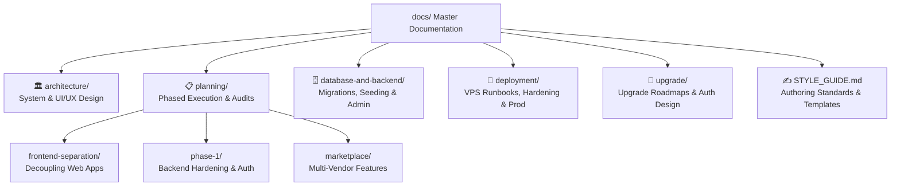

# 📚 Blue Panda Documentation Hub

Welcome to the centralized documentation knowledge base for the **Blue Panda E-Commerce Platform**. This hub organizes all architectural designs, implementation plans, progress logs, security audits, database procedures, and deployment runbooks.

---

## 🧭 Documentation Map & Taxonomy

---

## 🗂️ Documentation Directory Index

### 1. 🏛️ Architecture & System Design (`docs/architecture/`)
Comprehensive architectural blueprints, UI/UX breakdowns, and system specifications.

| Document | Description | Status |
|---|---|---|
| [**Marketplace Architecture Plan**](architecture/MARKETPLACE_ARCHITECTURE_PLAN.md) | Multi-vendor domain architecture, seller onboarding, split payouts, and catalog tenancy. | 📐 Architectural Blueprint |
| [**Storefront UI/UX Redesign Plan**](architecture/STOREFRONT_UI_REDESIGN_PLAN.md) | Visual design system, category-first discovery, flash sales, and modern storefront layouts. | 🎨 UI/UX Specification |
| [**Project UI/UX Analysis**](architecture/PROJECT_UI_UX_ANALYSIS.md) | Historical evaluation and recommendations for customer storefront and mobile UX. | 🔍 Design Review |
| [**Project Context & Baseline Audit**](../PROJECT_CONTEXT.md) | Ground-truth repository audit: stack verification, security posture, and database schema state. | 📌 Foundational Context |

---

### 2. 🚀 Deployment & Production Engineering (`docs/deployment/`)
Production infrastructure guides, Docker deployment specifications, security policies, and operational runbooks.

| Document | Description | Target Environment |
|---|---|---|
| [**VPS Deployment Runbook**](deployment/VPS_DEPLOYMENT_RUNBOOK.md) | Operator-ready, step-by-step Linux VPS deployment instructions with systemd and Docker Compose. | Production VPS |
| [**Production Readiness Audit**](deployment/PRODUCTION_READINESS_AUDIT.md) | Comprehensive audit assessing security, configuration, and infrastructure readiness. | Production Gate |
| [**Pre-Production Hardening Report**](deployment/PRE_PRODUCTION_HARDENING_REPORT.md) | Rate limiting, header security, pool sizing, and non-root Docker hardening audit. | Pre-Production |
| [**Production Readiness Report**](deployment/PRODUCTION_READINESS_REPORT.md) | Final verification report of production configurations and automated test coverage. | Production Sign-Off |
| [**Production Deployment Plan**](deployment/PRODUCTION_DEPLOYMENT_PLAN.md) | Single-VPS architecture design, container topology, reverse proxy, and SSL setup. | Planning |
| [**Production Git & Secret Policy**](deployment/PRODUCTION_GIT_SECRET_POLICY.md) | Mandatory rules for secret management, `.env` files, and source control hygiene. | All Workspaces |
| [**Production Progress Tracker**](deployment/PRODUCTION_PROGRESS.md) | Milestone tracker covering pre-production audits, runbooks, and staging readiness. | Ongoing |
| [**Staging Verification Report**](deployment/STAGING_VERIFICATION_REPORT.md) | Test results and smoke testing verification for staging container environments. | Staging |
| [**Render Deployment Guide**](deployment/RENDER_DEPLOYMENT_GUIDE.md) | Deployment instructions for Render web services and managed PostgreSQL databases. | PaaS / Render |

---

### 3. 🗄️ Database & Backend Procedures (`docs/database-and-backend/`)
Operational runbooks for database administration, initial account bootstrapping, and data seeding.

| Document | Description | Status |
|---|---|---|
| [**Admin Bootstrap Plan**](database-and-backend/ADMIN_BOOTSTRAP_PLAN.md) | Secure provisioning procedure for the initial administrative account via CLI. | 🛡️ Approved Procedure |
| [**Demo Product Seed Plan**](database-and-backend/DEMO_PRODUCT_SEED_PLAN.md) | Controlled catalog seeding script and verification procedure for development/staging. | 📦 Seeding Guide |
| [**Git Repository Migration Plan**](database-and-backend/GIT_REPOSITORY_MIGRATION_PLAN.md) | Topology analysis and migration plan for nested Git submodules and gitlinks. | 🔧 Repository Ops |

---

### 4. 📋 Planning & Phased Execution (`docs/planning/`)
Detailed execution checkpoints, security audits, and progress tracking broken down by initiative.

#### A. Frontend Separation (`docs/planning/frontend-separation/`)
Documents detailing the successful decoupling of the monolithic web-app into independent customer (`storefront/`) and admin (`management/`) applications.

- [**Frontend Separation Plan**](planning/frontend-separation/FRONTEND_SEPARATION_PLAN.md) — Strategic plan for splitting Next.js storefront and management portals.
- [**Frontend Separation Progress**](planning/frontend-separation/FRONTEND_SEPARATION_PROGRESS.md) — Checkpoint-by-checkpoint migration tracking.
- [**Frontend Separation Final Report**](planning/frontend-separation/FRONTEND_SEPARATION_FINAL_REPORT.md) — Completion report and verification of the decoupled architecture.
- [**Legacy Web App Cleanup Plan**](planning/frontend-separation/LEGACY_WEB_APP_CLEANUP_PLAN.md) — Safe decommissioning plan for the legacy `web-app/` directory.

#### B. Phase 1 Hardening & Security (`docs/planning/phase-1/`)
Initiative focused on backend security, role guards, and migration consolidation.

- [**Phase 1 Security Audit**](planning/phase-1/PHASE1_SECURITY_AUDIT.md) — Deep vulnerability inspection across authentication, authorization, and CORS.
- [**Phase 1 Progress Tracker**](planning/phase-1/PHASE1_PROGRESS.md) — Execution status for Alembic URL resolution and Docker startup fixes.
- [**Phase 1 Alembic Migration Plan**](planning/phase-1/PHASE1_ALEMBIC_MIGRATION_PLAN.md) — Migration baseline and schema consolidation strategy.
- [**Task 1 Authorization Report**](planning/phase-1/TASK1_AUTHORIZATION_REPORT.md) — Server-side role resolution implementation and test results.

#### C. Multi-Vendor Marketplace (`docs/planning/marketplace/`)
- [**Marketplace Progress**](planning/marketplace/MARKETPLACE_PROGRESS.md) — Status tracking for multi-vendor seller center construction and store management.

---

### 5. 🔄 Platform Upgrade & Modernization (`docs/upgrade/`)
Long-term platform roadmap, session-based authentication upgrade, and architectural modernization plans.

| Document | Description | Status |
|---|---|---|
| [**Upgrade Roadmap**](upgrade/BLUE_PANDA_UPGRADE_ROADMAP.md) | Comprehensive 4-phase roadmap covering security, marketplace architecture, and performance. | 🗺️ Strategic Roadmap |
| [**Project Upgrade Audit**](upgrade/BLUE_PANDA_PROJECT_AUDIT.md) | Diagnostic baseline audit prior to major platform modernization. | 📊 Baseline Audit |
| [**Upgrade Progress Tracker**](upgrade/BLUE_PANDA_PROGRESS.md) | Multi-sprint progress log tracking completed modernization tasks. | 📈 Active Tracking |
| [**Phase 1C Auth Security Design**](upgrade/PHASE_1C_AUTH_SECURITY_DESIGN.md) | Architectural specification for refresh tokens, session revocation, and NIST password policy. | 🔐 Security Design |
| [**Phase 1C Implementation Plan**](upgrade/PHASE_1C_IMPLEMENTATION_PLAN.md) | Detailed engineering checklist for implementing the Phase 1C authentication system. | 📝 Engineering Plan |

---

### 6. ✍️ Documentation Standards (`docs/STYLE_GUIDE.md`)
Guidelines, templates, and formatting rules to keep all Blue Panda documentation clean, readable, and easy to maintain.

- [**Blue Panda Documentation Style & Authoring Guide**](STYLE_GUIDE.md) — Document templates, frontmatter specs, alert conventions, and Mermaid diagram rules.

---

## 💡 Quick Search by Role

- **Storefront / Mobile Engineer:**
  - Start with [Storefront UI/UX Redesign Plan](architecture/STOREFRONT_UI_REDESIGN_PLAN.md)
  - Review [Frontend Separation Final Report](planning/frontend-separation/FRONTEND_SEPARATION_FINAL_REPORT.md)
  - Review [Auth Security Design](upgrade/PHASE_1C_AUTH_SECURITY_DESIGN.md)
- **Backend / Platform Engineer:**
  - Start with [Marketplace Architecture Plan](architecture/MARKETPLACE_ARCHITECTURE_PLAN.md)
  - Check [Alembic Migration Plan](planning/phase-1/PHASE1_ALEMBIC_MIGRATION_PLAN.md)
  - Check [Admin Bootstrap Plan](database-and-backend/ADMIN_BOOTSTRAP_PLAN.md)
- **DevOps / Security Engineer:**
  - Start with [VPS Deployment Runbook](deployment/VPS_DEPLOYMENT_RUNBOOK.md)
  - Review [Production Readiness Audit](deployment/PRODUCTION_READINESS_AUDIT.md)
  - Review [Production Git & Secret Policy](deployment/PRODUCTION_GIT_SECRET_POLICY.md)
