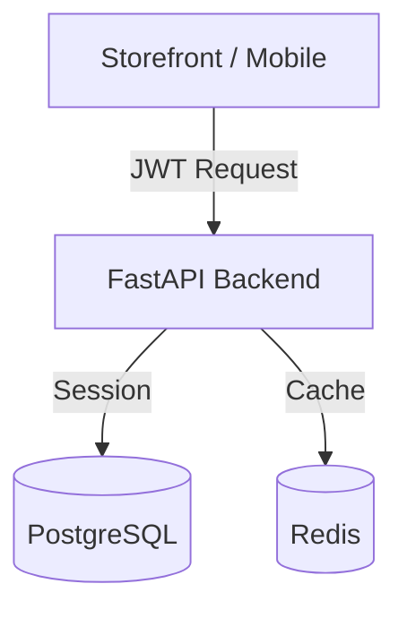

# Blue Panda Documentation Style & Authoring Guide

> **Standard:** Blue Panda Engineering Documentation Guidelines  
> **Audience:** Developers, Architects, AI Agents, and Technical Writers  
> **Status:** Active Standard

---

## 1. Core Principles

To ensure every document in the Blue Panda repository is **clean, readable, maintainable, and easy to write**, all technical documentation must adhere to the following principles:

1. **Truthful & Grounded:** Never document hypothetical or simulated features as working production capabilities. State what is verified, what is simulated, and what is planned.
2. **Structured & Scannable:** Use hierarchical headings (`#` through `####`), bullet points, tables, and visual diagrams. Readers should be able to scan sections in 30 seconds.
3. **No Secrets or Credentials:** Never commit real secrets, private tokens, connection strings, or environment credentials. Use generic placeholders (`<DB_PASSWORD>`, `your_jwt_secret`).
4. **Targeted Location:** Place documents into the appropriate `docs/` subcategory instead of dumping loose files in the repository root.

---

## 2. Directory Taxonomy & Where Documents Belong

Always author or relocate documents according to this taxonomy:

| Directory | Document Types & Contents | Examples |
|---|---|---|
| `docs/architecture/` | System design, domain models, UI/UX specifications, high-level architecture decisions. | `MARKETPLACE_ARCHITECTURE_PLAN.md`, `STOREFRONT_UI_REDESIGN_PLAN.md` |
| `docs/deployment/` | Production guides, Docker Compose specs, VPS runbooks, security hardening, disaster recovery. | `VPS_DEPLOYMENT_RUNBOOK.md`, `PRODUCTION_READINESS_AUDIT.md` |
| `docs/database-and-backend/` | Migrations, seeding scripts, admin bootstrapping, schema reference, data flow notes. | `ADMIN_BOOTSTRAP_PLAN.md`, `DEMO_PRODUCT_SEED_PLAN.md` |
| `docs/planning/` | Phase-specific planning, progress trackers, and audit reports organized by initiative. | `docs/planning/frontend-separation/`, `docs/planning/phase-1/` |
| `docs/upgrade/` | Version upgrade roadmaps, backward compatibility notes, major refactor designs. | `BLUE_PANDA_UPGRADE_ROADMAP.md`, `PHASE_1C_AUTH_SECURITY_DESIGN.md` |

> [!NOTE]
> Only repository-wide orientation files (`README.md`, `AGENTS.md`, `PROJECT_CONTEXT.md`) belong in the repository root. All other plans, audits, and guides must reside in `docs/`.

---

## 3. Standard Document Header (Frontmatter)

Every markdown document in `docs/` should open with a clear title and metadata block:

```markdown
# [Feature or Initiative Name] — [Document Type: Plan / Audit / Progress / Guide]

**Document Version:** 1.0.0  
**Date:** YYYY-MM-DD  
**Status:** [Draft | Under Review | Approved | Completed | Deprecated]  
**Target Scope:** [`backend/`, `storefront/`, `management/`, `mobile-app/`, or `deploy/`]  
**Related Documents:** [Link to parent plan or related audit]  

---
```

---

## 4. Markdown Formatting Conventions

### 4.1 Headings
- Use a single `# Level 1` heading for the document title.
- Use `## Level 2` for major sections.
- Use `### Level 3` for subsections.
- Avoid jumping heading levels (e.g., `#` directly to `###`).

### 4.2 GitHub-Style Alerts
Use callout boxes strategically to emphasize important points:

```markdown
> [!NOTE]
> Background context, architecture notes, or reference links.

> [!TIP]
> Practical tips, shortcuts, or developer performance advice.

> [!IMPORTANT]
> Critical prerequisites or rules that must be followed.

> [!WARNING]
> Breaking changes, version caveats, or migration dependencies.

> [!CAUTION]
> High-risk operations (e.g. database drop, destructive data changes).
```

### 4.3 Code Blocks
Always specify the syntax highlighter language identifier:
````markdown
```bash
# Run backend development server
cd backend && uvicorn app.main:app --reload
```

```python
# Synchronous database query
def get_user_by_id(db: Session, user_id: int) -> User | None:
    return db.query(User).filter(User.id == user_id).first()
```

```typescript
// Next.js Server Component
export default async function ProductPage({ params }: { params: { id: string } }) {
  const product = await getProduct(params.id);
  return <ProductView product={product} />;
}
```
````

### 4.4 Tables
Use tables for comparisons, status matrices, and checklists:

```markdown
| Feature / Check | Expected State | Current Verification | Status |
|---|---|---|---|
| Role Guards | Returns 403 for unauthorized users | Verified via pytest | ✅ Passing |
| Password Hashing | bcrypt with salt | Verified in `security.py` | ✅ Passing |
```

### 4.5 Mermaid Diagrams
Visual diagrams make complex architectures instantly clear. Use standard fenced `mermaid` blocks:



---

## 5. Document Authoring Templates

### Template A: Implementation / Architecture Plan

```markdown
# [System / Component] Implementation Plan

**Date:** YYYY-MM-DD  
**Author:** [Name or Agent Role]  
**Status:** Draft | In Progress | Ready for Execution  

---

## 1. Executive Summary & Goals
Brief 2-3 paragraph summary of why this change is needed and what it accomplishes.

## 2. Architecture & Design Specification
Describe data models, schemas, and API contracts.

### 2.1 Database & Schema Changes
Table definitions, migrations, and relationship impacts.

### 2.2 API Route Specification
Endpoints, methods, payload structures, and response shapes `{ success, message, data }`.

## 3. Step-by-Step Implementation Strategy
- [ ] **Step 1:** Data model and migration
- [ ] **Step 2:** Service layer business logic
- [ ] **Step 3:** Route handler and validation schemas
- [ ] **Step 4:** Client integration (Web / Mobile)

## 4. Security & Error Handling
Authorization guards, input sanitation, edge cases, and rollback procedures.

## 5. Verification & Test Plan
Automated tests to run, manual validation checklist, and sign-off criteria.
```

---

### Template B: Progress Tracker

```markdown
# [Initiative Name] — Progress Tracker

**Tracking Period:** [Start Date] to [Target Date]  
**Overall Status:** [On Track | In Progress | Blocked | Complete]  

---

## 1. Milestone Status Overview

| Milestone | Scope | Owner | Target Date | Status |
|---|---|---|---|---|
| Milestone 1 | Backend API & Schema | Backend Lead | YYYY-MM-DD | ✅ Complete |
| Milestone 2 | Frontend Client UI | Web Lead | YYYY-MM-DD | 🟡 In Progress |
| Milestone 3 | End-to-End Testing | QA / SRE | YYYY-MM-DD | ⚪ Not Started |

## 2. Detailed Task Breakdown
### Phase 1: Completed Work
- ✅ Task A: [Description of work and verified outcomes]

### Phase 2: Active Work
- 🟡 Task B: [Current task details, obstacles, and ETA]

## 3. Risks & Open Questions
1. **Risk:** [Potential bottleneck or dependency]
   - *Mitigation:* [Proposed workaround or solution]
```

---

### Template C: Audit & Verification Report

```markdown
# [System Area] Audit & Verification Report

**Audit Date:** YYYY-MM-DD  
**Auditor:** [Name or Agent Role]  
**Scope:** [Target directories and services audited]  
**Verdict:** [Ready | Conditionally Approved | Action Required]  

---

## 1. Executive Assessment
Summary of audit findings and overall readiness level.

## 2. Findings Matrix

| ID | Severity | Category | Description | Remediation | Status |
|---|---|---|---|---|---|
| SEC-01 | High | Authorization | Role bypass on endpoint | Added `require_admin` dependency | Resolved |
| PERF-02| Med | Database | Unindexed foreign key query | Added Alembic index migration | Pending |

## 3. Test & Verification Evidence
Command outputs, pytest passes, build logs, and regression checks.

## 4. Next Actions & Sign-Off
Explicit checklist of required actions before production or merge.
```
