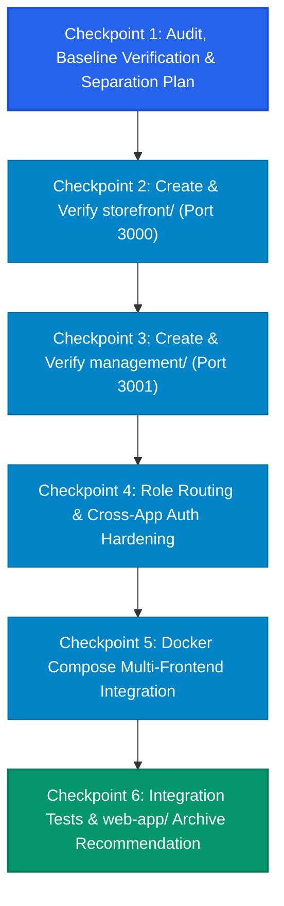

# Blue Panda E-Commerce — Frontend Separation Plan

**Document Version:** 1.0.0  
**Date:** 2026-10-31  
**Status:** Approved Architecture Plan for Execution  

---

## 1. Executive Summary & Migration Objectives

The Blue Panda e-commerce platform currently packages customer-facing storefront routes, administrative dashboards, point-of-sale (POS) modules, and merchant Seller Center views inside a single Next.js 16 application (`web-app/`).

### Target Architecture

We are separating this into two independent Next.js 16 applications:

```text
e-commerce/
├── storefront/                 # Customer-facing Next.js app (Port 3000)
├── management/                 # Admin + Seller Center Next.js app (Port 3001)
│   └── src/app/
│       ├── admin/              # Platform administration & POS
│       └── seller/             # Multi-vendor merchant center
├── backend/                    # Existing FastAPI REST API (Port 8000)
├── mobile-app/                 # Existing Flutter app
├── docker-compose.yml          # Unified multi-service local stack
├── MARKETPLACE_PROGRESS.md     # Ongoing multi-vendor feature tracking
├── FRONTEND_SEPARATION_PLAN.md # This architecture specification
├── FRONTEND_SEPARATION_PROGRESS.md # Migration execution log
└── README.md
```

### Target Local Service Topology

| Service | Target URL | Responsibilities | Access Roles |
| :--- | :--- | :--- | :--- |
| **Storefront** | `http://localhost:3000` | Catalog browsing, search, categories, cart, checkout, orders, customer profile | Public / Customer |
| **Management** | `http://localhost:3001` | Back-office management, seller center, products administration, POS, order fulfillment | Admin & Seller |
| **FastAPI Backend** | `http://localhost:8000` | REST API, OAuth2/JWT auth, database access, upload serving | All clients |
| **pgAdmin 4** | `http://localhost:5050` | Database administrative UI | Developers |
| **PostgreSQL 16** | `127.0.0.1:5433` (host) | Relational persistence | Backend / Docker |

### Architectural & Security Benefits
1. **Reduced Attack Surface**: Administrative and merchant source code, components, mutation hooks, and private route metadata are excluded from customer client bundles.
2. **Bundle Size & Performance**: Customers download only storefront JS; merchant and admin dashboards load independently without polluting consumer CWV metrics.
3. **Independent Session Lifecycles**: Customers and platform administrators maintain distinct, non-colliding authentication states, localStorage keys, and session epochs.
4. **Isolated Deployability**: Storefront and management portals can scale, deploy, and restart independently in production environments.

---

## 2. Baseline Audit & Pre-Migration Verification

A complete baseline audit of `web-app/` and the backend was executed prior to initiating any file migration.

### 2.1 Git Status & Safety Invariant
The current workspace contains uncommitted work from recent Phase 1 and Phase C tasks:
- `backend/`: Updated routes, migration fix, seller products endpoint (`test_seller_products.py`).
- `web-app/`: Uncommitted seller center routes (`src/app/(seller)/`), store components, checkout security logic, and unit tests (`51` passed tests in `src/lib/__tests__/`).
- **Safety Rule**: `web-app/` remains completely untouched during the initial extraction phases. No files in `web-app/` will be deleted, moved, or altered until both `storefront/` and `management/` are fully created, independently tested, and approved.

### 2.2 Verified Baseline Test Results
- **Frontend Unit Tests (`web-app/npm test`)**: **51 passed, 0 failed** (duration 116ms)
  - Task B.1 Role Routing & Interface Segregation: 23 passed
  - Task B.2 Seller Store Profile: 15 passed
  - Task C.1 Seller Products Listing: 13 passed
- **Storefront Security Tests (`checkout-security.test.ts` & `session-isolation.test.ts`)**: **13 passed, 0 failed**
  - Checkout & Coupon Security: 5 passed
  - Session Isolation & Logout Cache: 8 passed
- **TypeScript Static Verification (`web-app/npx tsc --noEmit`)**: **0 errors, 0 warnings**
- **Next.js Production Build (`web-app/npm run build`)**: **Clean exit code 0**, all 43 routes compiled and statically optimized.
- **Backend Regression Suite (`pytest tests/test_seller_*.py`)**: **38 passed, 0 failed** in 2.69s.

---

## 3. Detailed File Migration & Separation Map

### 3.1 Public Assets (`public/`)

| Original Path (`web-app/`) | Target in `storefront/` | Target in `management/` | Rationale |
| :--- | :--- | :--- | :--- |
| `public/images/logo_panda_blue.png` | `public/images/logo_panda_blue.png` | `public/images/logo_panda_blue.png` | Brand logo used in navbars, footers, and auth forms. |
| `public/icons/user-role.svg` | Omitted | `public/icons/user-role.svg` | Management-specific role icon. |
| `public/robots.txt` | `public/robots.txt` (Permissive indexable) | `public/robots.txt` (`Disallow: /`) | Management portal should disallow public web crawlers. |

### 3.2 Root Configuration & Boilerplate

| File | Target in `storefront/` | Target in `management/` | Notes |
| :--- | :--- | :--- | :--- |
| `package.json` | `storefront/package.json` | `management/package.json` | Both use Next 16.3.4, React 19.2.8, Tailwind 4. `storefront` retains `zustand`; `management` omits `zustand`. |
| `tsconfig.json` | `storefront/tsconfig.json` | `management/tsconfig.json` | Strict TypeScript with `@/*` pointing to `./src/*`. |
| `next.config.ts` | `storefront/next.config.ts` | `management/next.config.ts` | SVGR loader & remote image patterns (`localhost:8000`, `127.0.0.1:8000`). |
| `postcss.config.mjs` | `storefront/postcss.config.mjs` | `management/postcss.config.mjs` | Standard Tailwind CSS 4 PostCSS runner. |
| `eslint.config.mjs` | `storefront/eslint.config.mjs` | `management/eslint.config.mjs` | Standard Next.js ESLint configuration. |
| `src/app/globals.css` | `src/app/globals.css` | `src/app/globals.css` | Shared Tailwind 4 base styling and Plus Jakarta Sans variables. |
| `src/app/layout.tsx` | `src/app/layout.tsx` (Customer metadata) | `src/app/layout.tsx` (Management portal metadata) | Tailored HTML root shells. |

### 3.3 Application Routes (`src/app/`)

#### Storefront Application (`storefront/src/app/`)

| Route Path | Original Source | Feature Scope |
| :--- | :--- | :--- |
| `src/app/page.tsx` | `src/app/(store)/page.tsx` | Marketplace homepage, hero banner, category grid, featured products, deals |
| `src/app/shop/page.tsx` | `src/app/(store)/shop/page.tsx` | Catalog discovery, filters, search, sorting |
| `src/app/product/[id]/page.tsx` | `src/app/(store)/product/[id]/page.tsx` | Product details, image gallery, reviews, add to cart |
| `src/app/categories/page.tsx` | `src/app/(store)/categories/page.tsx` | Category directory |
| `src/app/cart/page.tsx` | `src/app/(store)/cart/page.tsx` | Shopping cart drawer / cart management |
| `src/app/checkout/page.tsx` | `src/app/(store)/checkout/page.tsx` | Address selection, delivery method, payment, order placement |
| `src/app/wishlist/page.tsx` | `src/app/(store)/wishlist/page.tsx` | Customer saved items / favorites |
| `src/app/deals/page.tsx` | `src/app/(store)/deals/page.tsx` | Active promotions & verified seller coupons |
| `src/app/stores/page.tsx` | `src/app/(store)/stores/page.tsx` | Verified merchant store directory |
| `src/app/orders/page.tsx` | `src/app/(store)/orders/page.tsx` | Customer order tracking & history |
| `src/app/account/page.tsx` | `src/app/(store)/account/page.tsx` | Customer account details, address book |
| `src/app/layout.tsx` | `src/app/(store)/layout.tsx` | Store shell: StoreNavbar, StoreFooter, CartDrawer, QuickView, SearchCommand, ToastViewport |
| `src/app/(auth)/login/page.tsx` | `src/app/(auth)/login/page.tsx` | Customer authentication (redirects to `/` or requested customer path) |
| `src/app/(auth)/register/page.tsx` | `src/app/(auth)/register/page.tsx` | Customer account registration |

#### Management Application (`management/src/app/`)

| Route Path | Original Source | Role Guard | Feature Scope |
| :--- | :--- | :--- | :--- |
| `src/app/page.tsx` | New Root Redirector | — | Redirects authenticated admin to `/admin/dashboard`, seller to `/seller`, unauthenticated to `/login`. |
| `src/app/(auth)/login/page.tsx` | `src/app/(auth)/login/page.tsx` | — | Management login portal with Admin / Seller role redirection. |
| `src/app/(auth)/register/page.tsx` | `src/app/(auth)/register/page.tsx` | — | Merchant onboarding / registration. |
| `src/app/admin/layout.tsx` | `src/app/(admin)/admin/layout.tsx` | `admin` | Admin shell with AdminSidebar, Header, role guard. |
| `src/app/admin/dashboard/page.tsx` | `src/app/(admin)/admin/dashboard/page.tsx` | `admin` | Platform analytics, revenue cards, recent orders. |
| `src/app/admin/products/*` | `src/app/(admin)/admin/products/*` | `admin` | Platform product moderation, listing, creation. |
| `src/app/admin/orders/*` | `src/app/(admin)/admin/orders/*` | `admin` | Global order inspection and status management. |
| `src/app/admin/categories/*` | `src/app/(admin)/admin/categories/*` | `admin` | Category hierarchy management. |
| `src/app/admin/customers/*` | `src/app/(admin)/admin/customers/*` | `admin` | Customer accounts oversight. |
| `src/app/admin/sellers/*` | `src/app/(admin)/admin/sellers/*` | `admin` | Seller verification and store oversight. |
| `src/app/admin/inventory/*` | `src/app/(admin)/admin/inventory/*` | `admin` | Stock adjustments and low-stock alerts. |
| `src/app/admin/pos/page.tsx` | `src/app/(admin)/admin/pos/page.tsx` | `admin` | Point of sale cashier interface. |
| `src/app/admin/analytics/page.tsx` | `src/app/(admin)/admin/analytics/page.tsx` | `admin` | Business performance and sales reports. |
| `src/app/admin/reports/page.tsx` | `src/app/(admin)/admin/reports/page.tsx` | `admin` | Exportable reporting summaries. |
| `src/app/admin/payments/*` | `src/app/(admin)/admin/payments/*` | `admin` | Payment log inspection. |
| `src/app/admin/refunds/*` | `src/app/(admin)/admin/refunds/*` | `admin` | Refund request resolution. |
| `src/app/admin/transactions/*` | `src/app/(admin)/admin/transactions/*` | `admin` | Financial transaction audit. |
| `src/app/admin/suppliers/*` | `src/app/(admin)/admin/suppliers/*` | `admin` | Supply chain vendor catalog. |
| `src/app/admin/employees/*` | `src/app/(admin)/admin/employees/*` | `admin` | Internal staff accounts. |
| `src/app/admin/roles/*` | `src/app/(admin)/admin/roles/*` | `admin` | Role permissions matrix. |
| `src/app/admin/reviews/*` | `src/app/(admin)/admin/reviews/*` | `admin` | Customer review moderation. |
| `src/app/admin/notifications/page.tsx`| `src/app/(admin)/admin/notifications/page.tsx`| `admin` | Admin system notifications. |
| `src/app/admin/settings/page.tsx` | `src/app/(admin)/admin/settings/page.tsx` | `admin` | Marketplace settings. |
| `src/app/admin/profile/page.tsx` | `src/app/(admin)/admin/profile/page.tsx` | `admin` | Admin profile settings. |
| `src/app/seller/layout.tsx` | `src/app/(seller)/seller/layout.tsx` | `seller` | Dedicated Seller Center shell with SellerSidebar & SellerNavbar. |
| `src/app/seller/page.tsx` | `src/app/(seller)/seller/page.tsx` | `seller` | Multi-vendor seller overview dashboard. |
| `src/app/seller/products/page.tsx` | `src/app/(seller)/seller/products/page.tsx` | `seller` | Tenant-scoped seller product catalog and stock oversight. |
| `src/app/seller/store/page.tsx` | `src/app/(seller)/seller/store/page.tsx` | `seller` | Seller store profile self-service configuration. |

### 3.4 Components Directory Allocation

#### Storefront Components (`storefront/src/components/store/`)
- `CartDrawer.tsx`
- `ProductCard.tsx`
- `QuickViewDialog.tsx`
- `SearchCommandDialog.tsx`
- `StoreFooter.tsx`
- `StoreNavbar.tsx`
- `ToastViewport.tsx`

#### Management Components (`management/src/components/`)
- **Admin Shell (`management/src/components/layout/`)**:
  - `AdminSidebar.tsx`
  - `DashboardLayout.tsx`
  - `Navbar.tsx`
  - `Sidebar.tsx`
- **Seller Shell (`management/src/components/seller/`)**:
  - `SellerLayout.tsx`
  - `SellerNavbar.tsx`
  - `SellerSidebar.tsx`

### 3.5 Core Library & State Modules (`src/lib/`)

| Module | Storefront Destination | Management Destination | Strategy / Differences |
| :--- | :--- | :--- | :--- |
| `lib/utils.ts` | `storefront/src/lib/utils.ts` | `management/src/lib/utils.ts` | Pure utility (`cn` helper using `clsx` and `tailwind-merge`). |
| `lib/store.ts` | `storefront/src/lib/store.ts` | **Excluded** | Persisted Zustand store for customer commerce (cart, favorites, recently viewed). Not needed in management portal. |
| `lib/store-catalog.ts` | `storefront/src/lib/store-catalog.ts` | **Excluded** | Storefront fallback catalog and currency/price helpers. Admin/Seller portals interact directly with PostgreSQL backend. |
| `lib/checkout-security.ts` | `storefront/src/lib/checkout-security.ts` | **Excluded** | Storefront checkout validation, coupon redemption verification, and payment guard. |
| `lib/api.ts` | `storefront/src/lib/api.ts` | `management/src/lib/api.ts` | Scoped API contracts. Storefront contains public & customer endpoints; management contains admin, POS, and seller APIs. |
| `lib/auth.ts` | `storefront/src/lib/auth.ts` | `management/src/lib/auth.ts` | Independent session storage keys and role routing destinations. |

---

## 4. Session & Storage Isolation Strategy

Because both applications run locally during development (ports 3000 and 3001), sharing or conflicting with `localStorage` keys is a known risk if identical keys are used without namespacing or origin isolation.

While `localStorage` is isolated per origin (`http://localhost:3000` vs `http://localhost:3001`) in standard modern browsers, defensive namespacing will be enforced to guarantee zero ambiguity:

### Storage Key Isolation Matrix

| Storage Key | Storefront (`:3000`) | Management (`:3001`) | Scope & Purpose |
| :--- | :--- | :--- | :--- |
| Auth Status | `storefront_isLoggedIn` | `mgmt_isLoggedIn` | Distinct session lifecycle |
| Access Token | `storefront_accessToken` | `mgmt_accessToken` | Independent bearer token |
| User Profile | `storefront_currentUser` | `mgmt_currentUser` | Scoped user entity |
| State Cache | `blue-panda-shop-storage` | *(none)* | Customer cart / wishlist persistence |
| Merchant Caches| *(none)* | `pos_parked_carts`, `mgmt_notif_*` | POS / Cashier state |

### Cross-Site Navigation & Open Redirect Prevention
- When a user logs into `storefront` (`:3000`) with an `admin` or `seller` account:
  - If configured, an informative banner or seamless redirect link to `http://localhost:3001/admin/dashboard` or `http://localhost:3001/seller` is provided.
- When a user logs into `management` (`:3001`) with a `customer` account:
  - Access is explicitly denied with an error: *"Access denied. The management portal is restricted to merchant sellers and platform administrators."*
  - A secure return link to `http://localhost:3000` is provided.
- Any cross-application redirect validates destination URLs against an allowlist of permitted origins (`http://localhost:3000`, `http://localhost:3001`, `http://127.0.0.1:3000`, `http://127.0.0.1:3001`). Protocol-relative (`//`) or backslash (`/\`) bypasses remain strictly blocked.

---

## 5. Backend CORS & Endpoint Integration

### 5.1 CORS Configuration Update
To support both frontends simultaneously:
1. `backend/app/core/config.py`:
   - Extend `DEFAULT_DEV_CORS_ORIGINS` to include:
     - `http://localhost:3001`
     - `http://127.0.0.1:3001`
2. `docker-compose.yml`:
   - Update `CORS_ORIGINS` environment variable for `backend`:
     ```yaml
     CORS_ORIGINS: ${CORS_ORIGINS:-http://localhost:3000,http://localhost:3001,http://localhost:8000,http://127.0.0.1:3000,http://127.0.0.1:3001,http://10.0.2.2:8000}
     ```

### 5.2 API Route Preservation
- All existing endpoints under `/api` and `/api/v1` remain unchanged.
- Backend RBAC (`require_roles("admin")`, `require_roles("seller", "admin")`) remains the authoritative security barrier.

---

## 6. Docker Compose Multi-Frontend Architecture

The root `docker-compose.yml` will be updated in Checkpoint 5 to run five coordinated services:

```yaml
services:
  postgres:
    image: postgres:16-alpine
    ports: ["127.0.0.1:5433:5432"]
    volumes: [postgres_data:/var/lib/postgresql/data]

  pgadmin:
    image: dpage/pgadmin4:latest
    ports: ["5050:80"]
    volumes: [pgadmin_data:/var/lib/pgadmin]

  backend:
    build: { context: ./backend, dockerfile: Dockerfile }
    ports: ["8000:8000"]
    environment:
      CORS_ORIGINS: "http://localhost:3000,http://localhost:3001,http://localhost:8000,http://127.0.0.1:3000,http://127.0.0.1:3001"

  storefront:
    build:
      context: ./storefront
      dockerfile: Dockerfile
      args:
        NEXT_PUBLIC_API_URL: ${NEXT_PUBLIC_API_URL:-http://localhost:8000/api}
    ports: ["3000:3000"]
    environment:
      PORT: 3000
      NEXT_PUBLIC_API_URL: http://localhost:8000/api
      NEXT_PUBLIC_MANAGEMENT_URL: http://localhost:3001

  management:
    build:
      context: ./management
      dockerfile: Dockerfile
      args:
        NEXT_PUBLIC_API_URL: ${NEXT_PUBLIC_API_URL:-http://localhost:8000/api}
    ports: ["3001:3001"]
    environment:
      PORT: 3001
      NEXT_PUBLIC_API_URL: http://localhost:8000/api
      NEXT_PUBLIC_STOREFRONT_URL: http://localhost:3000
```

---

## 7. Checkpoint Execution Sequence



- **Checkpoint 1 (Completed Now)**: Static code inspection, baseline build/test verification, exact file mapping, and plan documentation.
- **Checkpoint 2 (Next)**: Scaffold `storefront/`, copy customer assets/pages/components, configure build scripts, verify `npm test`, `tsc`, and `next build`.
- **Checkpoint 3**: Scaffold `management/`, copy admin and seller assets/pages/components, configure build scripts, verify `npm test`, `tsc`, and `next build`.
- **Checkpoint 4**: Configure isolated session keys, update post-login redirection, test cross-site role guards and open redirect rejection.
- **Checkpoint 5**: Update backend CORS configuration and `docker-compose.yml` for dual-frontend orchestration.
- **Checkpoint 6**: Execute end-to-end integration verification across both apps and backend, followed by formal cleanup recommendation.
