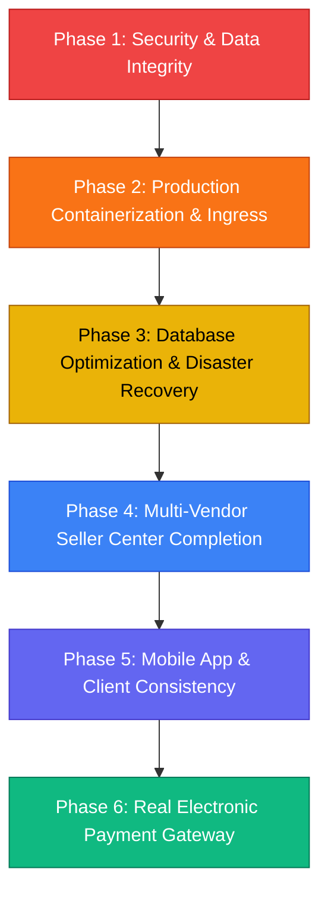

# Blue Panda E-Commerce — Production Upgrade Roadmap

**Document:** Comprehensive Phased Implementation Plan  
**Version:** 1.0.0  
**Date:** 2026-11-03  
**Status:** Approved for Implementation (Read-Only Planning Phase)  
**Authors:** Senior Software Architect, Full-Stack Engineer, Security Engineer, DevOps Engineer  

---

## 1. Roadmap Architecture & Execution Principles

This roadmap transitions Blue Panda from a local development marketplace into a secure, highly performant, observable, and fully truthful production platform.

### Core Engineering Invariants
1. **Security & Data Integrity First:** Core vulnerabilities, token leakage, ambiguous ID mutations, and untruthful stats must be resolved before introducing new features.
2. **Zero Startup Migrations in Production:** Database migrations must never run automatically on application startup. Schema changes must execute through an isolated, operator-reviewed procedure following a verified database backup.
3. **Truthful Commerce Guarantees:** No simulated payment successes, no fake revenue fallbacks, and no silent demo mocks in production builds. If a service is offline or a payment is unverified, the system must fail closed with explicit user feedback.
4. **Client-Server Parity:** All API mutations, cart endpoints, and auth lifecycles must be harmonized across the Customer Storefront, Admin/Seller Management Portal, and Flutter Mobile Application.
5. **Non-Destructive Execution:** The legacy `web-app/` codebase is preserved as a verified reference fallback. Existing working tests must remain green across all phases.

---

## 2. Master Implementation Phases Overview



| Phase | Focus Area | Primary Deliverables | Risk Level | Est. Complexity |
| :--- | :--- | :--- | :--- | :--- |
| **Phase 1** | Security & Data Integrity | Rate limiting, truthful stats, cart ID fix, JWT blacklist & refresh endpoint | High | Medium |
| **Phase 2** | Production Containerization | Multi-stage Dockerfiles, decoupled migrations, `/readyz` probe, structured JSON logs | Critical | High |
| **Phase 3** | Database & Disaster Recovery | GIN trigram search indexes, compound indexes, pool tuning, automated backup/restore | High | Medium |
| **Phase 4** | Seller Center Completion | Product wizard (`/seller/products/new`), inventory oversight, seller order fulfillment | Medium | High |
| **Phase 5** | Mobile & Client Parity | Mobile refresh token integration, cart endpoint fix, image policy hardening, a11y | Medium | Medium |
| **Phase 6** | Payment Gateway Integration | Real payment processor (Stripe/Bakong), webhook verification, idempotency, refunds | High | High |

---

## 3. Detailed Phase Specifications

---

### Phase 1: Production Blocking Security & Data Integrity

#### Objective
Eliminate critical security vulnerabilities, remove misleading development data fallbacks, resolve ambiguous cart item mutations, and introduce a secure authentication session lifecycle.

#### Existing Problems
1. **Ineffective Logout / JWT Revocation Gap:** `POST /api/v1/auth/logout` is a no-op returning `{"success": True}`; stolen or stale JWT tokens remain valid for up to 7 days.
2. **Missing Token Refresh Flow:** Mobile defines `ApiEndpoints.refreshToken = '/api/v1/auth/refresh'`, which returns HTTP 404 on the backend.
3. **Ambiguous Cart Item Targeting:** `backend/app/services/cart_service.py` matches `(CartItem.id == item_id) | (CartItem.product_id == item_id)`, leading to cross-item collisions between cart primary keys and product IDs.
4. **Untruthful Revenue Preview:** `backend/app/api/v1/routes/stats.py` (lines 29–31) falls back to summing all orders (including unpaid, cancelled, and pending) when paid revenue is $0.
5. **No Rate Limiting:** `/register`, `/login`, `/me`, and public routes lack abuse protection, allowing brute-force password guessing and DoS.
6. **Permissive Password Policy:** Passwords only enforce a 6-character minimum without entropy or complexity checks.

#### Source Files Involved
- `backend/app/api/v1/routes/auth.py`
- `backend/app/api/v1/routes/cart.py`
- `backend/app/api/v1/routes/stats.py`
- `backend/app/core/security.py`
- `backend/app/core/dependencies.py`
- `backend/app/models/user.py`
- `backend/app/schemas/user.py`
- `backend/app/schemas/cart.py`
- `backend/app/services/auth_service.py`
- `backend/app/services/cart_service.py`
- `storefront/src/lib/api.ts`

#### Proposed Changes
1. **Token Revocation & Refresh Token Flow:**
   - Introduce an `ActiveSession` or `RevokedToken` model / in-memory cache to record revoked JWT JTIs (token identifiers) upon logout.
   - Implement `POST /api/v1/auth/refresh` that accepts a refresh token (or valid unexpired session), issues a new access token, and rotates credentials.
   - Update `POST /api/v1/auth/logout` to extract the JWT `jti`, add it to the revocation registry, and terminate the session.
2. **Truthful Statistics Query:**
   - Remove lines 29–31 from `backend/app/api/v1/routes/stats.py`. If paid orders total $0.00, return `$0.00` strictly. Never sum unpaid or pending orders as revenue.
3. **Deterministic Cart Endpoints:**
   - Explicitly separate cart item targeting:
     - `PUT /api/v1/cart/items/{item_id}`: Targets `CartItem.id == item_id` strictly.
     - `DELETE /api/v1/cart/items/{item_id}`: Targets `CartItem.id == item_id` strictly.
     - Add `DELETE /api/v1/cart/product/{product_id}`: Dedicated endpoint targeting `CartItem.product_id == product_id` to cleanly support clients that only store product IDs.
   - Eliminate `(CartItem.id == item_id) | (CartItem.product_id == item_id)` query conditions.
4. **Rate Limiting with Slowapi:**
   - Integrate `slowapi` with in-memory or Redis-backed rate limiter on FastAPI.
   - Apply strict limits: `5 requests/minute` on `/auth/login` and `/auth/register`, `20 requests/minute` on sensitive user mutations, and `120 requests/minute` on public catalog endpoints.
5. **Password Policy Enforcement:**
   - Update `UserRegisterRequest` and `PasswordChangeRequest` schemas: minimum 8 characters, requiring at least one number, one uppercase letter, and one special character.

#### Dependencies
- None. Can be implemented immediately on existing backend.

#### Risks & Mitigations
- *Risk:* Existing users with simple passwords cannot log in.  
  *Mitigation:* Apply strict password policy only to *new* registrations and password update requests; do not block login for existing accounts.
- *Risk:* Slowapi memory leak under heavy traffic if using simple in-memory storage.  
  *Mitigation:* Use bounded memory key expiry or Redis backend.

#### Acceptance Criteria
- [ ] `POST /api/v1/auth/logout` invalidates the token; subsequent requests using that token return `401 Unauthorized`.
- [ ] `POST /api/v1/auth/refresh` returns a valid new access token when provided a valid refresh token.
- [ ] `GET /api/v1/stats/overview` returns `$0.00` when no paid orders exist, never falling back to unpaid order sums.
- [ ] Updating or removing a cart item strictly targets the intended cart item ID without collateral impact on other items.
- [ ] Sending 6 failed login attempts in 1 minute triggers `429 Too Many Requests`.

#### Tests Required
- `backend/tests/test_auth_revocation.py`: Verify logout invalidates JWT, refresh token rotation, and expired token rejection.
- `backend/tests/test_stats_truthfulness.py`: Verify revenue calculation with 0 paid orders, mixed orders, and cancelled orders.
- `backend/tests/test_cart_deterministic_targeting.py`: Verify cart mutations with colliding item IDs and product IDs.
- `backend/tests/test_rate_limiting.py`: Verify 429 response upon exceeding endpoint threshold.

#### Estimated Complexity
- **Complexity:** Medium (3–4 days).

---

### Phase 2: Production Containerization & High-Availability Ingress

#### Objective
Transition all services from development containers (`next dev`, Uvicorn `--reload`, root users) into immutable, non-root, multi-stage production Docker images orchestrated behind Caddy with health/readiness separation.

#### Existing Problems
1. **Development Runtime in Containers:** `storefront/Dockerfile` and `management/Dockerfile` run `npm run dev` as root. `backend/Dockerfile` runs Uvicorn with `--reload` and compiler build tools.
2. **Coupled Startup Migrations:** `backend/docker-entrypoint.sh` executes `alembic upgrade head`, table initialization, and seeding on every container startup.
3. **Static Liveness Probe:** `/health` returns static `{"status": "healthy"}` without verifying database connectivity.
4. **Lack of Structured Logging:** FastAPI logs unstructured text strings to stdout, preventing automated error parsing and log aggregation in production.

#### Source Files Involved
- `backend/Dockerfile` -> `backend/Dockerfile.prod`
- `storefront/Dockerfile` -> `storefront/Dockerfile.prod`
- `storefront/next.config.ts`
- `management/Dockerfile` -> `management/Dockerfile.prod`
- `management/next.config.ts`
- `deploy/production/compose.yaml`
- `deploy/production/Caddyfile`
- `backend/app/main.py`
- `backend/app/core/logging_config.py`

#### Proposed Changes
1. **Multi-Stage Production Dockerfiles:**
   - **Frontend Dockerfiles (`storefront` & `management`):**
     - Stage 1 (`deps`): Install dependencies using `npm ci --frozen-lockfile`.
     - Stage 2 (`builder`): Build Next.js with `output: "standalone"`.
     - Stage 3 (`runner`): Alpine base, unprivileged `nextjs` user (`UID 1001`), copy standalone assets and static files, run `node server.js`.
   - **Backend Dockerfile (`backend`):**
     - Stage 1 (`builder`): Install C compiler, build Python wheels into `/root/wheels`.
     - Stage 2 (`runner`): Python 3.12-slim, install wheels without compiler dependencies, create unprivileged `bluepanda` user (`UID 10001`), copy source code, run Uvicorn with `--workers 2..4` without `--reload`.
2. **Decoupled Migration Runner:**
   - Create a dedicated migration Compose service profile or CLI script:
     ```bash
     rtk docker compose run --rm backend-migration alembic upgrade head
     ```
   - Ensure `AUTO_INIT_DB=false` and `SEED_DEMO_DATA=false` in production. Production backend entrypoint must NEVER invoke Alembic or seed data.
3. **Database Readiness Probe (`/readyz`):**
   - Add `/readyz` endpoint in `backend/app/main.py`: executes `SELECT 1` with a 2-second timeout.
   - Keep `/health` as a lightweight process liveness probe.
   - Configure Docker healthcheck and Caddy upstream checks to utilize `/readyz`.
4. **Structured JSON Logging:**
   - Implement Python standard logging with JSON formatter (timestamp, log level, message, module, request ID, client IP).
   - Add middleware to extract or generate `X-Request-ID` and attach it to both logging context and response headers.

#### Dependencies
- Completion of Phase 1.

#### Risks & Mitigations
- *Risk:* `output: "standalone"` Next.js builds miss public assets or environment variables.  
  *Mitigation:* Explicitly copy `.next/static` to `.next/standalone/.next/static` and `public` to `.next/standalone/public` in Dockerfile. Verify client-side bundles load correctly.

#### Acceptance Criteria
- [ ] All containers run as unprivileged users (`UID != 0`) with read-only root filesystems (except `/tmp`).
- [ ] Next.js frontends execute `node server.js` in standalone mode; bundle size reduced by >50%.
- [ ] Backend starts without compiling dependencies at runtime and without running migrations.
- [ ] `/readyz` returns HTTP 200 when DB is connected, and HTTP 503 when DB is stopped.
- [ ] Access logs output valid JSON containing `request_id`.

#### Tests Required
- Container build and execution test on clean Docker engine.
- Container non-root execution check: `docker exec <container> id` confirms non-zero UID.
- Failure drill: Stop PostgreSQL container, verify `/readyz` returns 503 while `/health` returns 200.

#### Estimated Complexity
- **Complexity:** High (4–5 days).

---

### Phase 3: Database Optimization, Indexing & Disaster Recovery

#### Objective
Optimize PostgreSQL for high-concurrency production load, eliminate sequential table scans during product search, and establish verified automated backup and disaster recovery procedures.

#### Existing Problems
1. **Unindexed Full-Text Search:** Searching products via `name.ilike('%query%')` executes expensive full-table scans.
2. **Missing Compound Indexes:** Filtering by category, seller, and active status causes multi-index bitmap scans.
3. **Unconfigured SQLAlchemy Connection Pooling:** Implicit default pool (`pool_pre_ping=True`) without tuning `pool_size`, `max_overflow`, or `pool_recycle`.
4. **Missing Disaster Recovery Automation:** No automated database dump script, encryption, offsite copy, or documented restore drill.

#### Source Files Involved
- `backend/alembic/versions/` (New migration)
- `backend/app/models/product.py`
- `backend/app/models/order.py`
- `backend/app/db/database.py`
- `backend/app/core/config.py`
- `deploy/production/scripts/backup.sh`
- `deploy/production/scripts/restore.sh`

#### Proposed Changes
1. **PostgreSQL Trigram & Compound Indexes:**
   - Create Alembic migration:
     - Enable `pg_trgm` extension in PostgreSQL (`CREATE EXTENSION IF NOT EXISTS pg_trgm;`).
     - Create GIN index on `products` for `(name gin_trgm_ops)` and `(description gin_trgm_ops)`.
     - Create compound index on `products(category_id, is_active, created_at DESC)`.
     - Create compound index on `products(seller_id, is_active)`.
     - Create compound index on `orders(user_id, created_at DESC)`.
     - Create compound index on `orders(status, payment_status)`.
2. **Production Connection Pool Tuning:**
   - Configure `create_engine` parameters in `backend/app/db/database.py`:
     ```python
     engine = create_engine(
         settings.DATABASE_URL,
         pool_pre_ping=True,
         pool_size=settings.DB_POOL_SIZE,        # default: 10
         max_overflow=settings.DB_MAX_OVERFLOW,   # default: 20
         pool_recycle=settings.DB_POOL_RECYCLE,   # default: 1800 (30 mins)
         pool_timeout=settings.DB_POOL_TIMEOUT,   # default: 30
     )
     ```
3. **Automated Backup & Restore Scripts:**
   - Create `deploy/production/scripts/backup.sh`:
     - Executes `pg_dump -Fc` against PostgreSQL.
     - Compresses and encrypts with GPG / AES-256.
     - Prunes backups older than retention policy (e.g., 14 daily, 8 weekly).
   - Create `deploy/production/scripts/restore.sh`:
     - Safely decrypts and restores a specified backup file to a target database with verification checks.
   - Document step-by-step disaster recovery drill in `docs/runbooks/DISASTER_RECOVERY.md`.

#### Dependencies
- Completion of Phase 2 (Docker and migration runbook).

#### Risks & Mitigations
- *Risk:* Creating GIN indexes on large tables can lock writes.  
  *Mitigation:* Use `CONCURRENTLY` in PostgreSQL migration if executed on an active database.

#### Acceptance Criteria
- [ ] Product search queries with `ilike` utilize trigram GIN indexes (verified via `EXPLAIN ANALYZE`).
- [ ] Database connection pool metrics logged and visible.
- [ ] `backup.sh` successfully creates an encrypted `.dump.gpg` file.
- [ ] `restore.sh` successfully restores the database into a clean test container with 100% data integrity.

#### Tests Required
- `backend/tests/test_database_indexing.py`: Verify migration applies and index creation is verified.
- Automated drill test: Run `backup.sh`, drop test table, run `restore.sh`, verify dropped table is restored.

#### Estimated Complexity
- **Complexity:** Medium (3 days).

---

### Phase 4: Multi-Vendor Seller Center Completion (Phases C.2, C.3, D)

#### Objective
Complete the unfinished features of the Multi-Vendor Seller Center, enabling independent sellers to create/edit products, manage stock levels, view their incoming orders, and review store revenue without admin intervention.

#### Existing Problems
1. **Disabled Product Creation/Editing (Phase C.2):** `/seller/products/new` and `/seller/products/[id]/edit` are disabled with placeholder badges in `management/src/app/(seller)/seller/products/page.tsx`.
2. **No Seller Inventory Oversight (Phase C.3):** No dedicated screen exists for sellers to monitor low-stock items or perform bulk stock replenishment.
3. **No Seller Order Management or Metrics (Phase D):** Sellers cannot view orders containing their products or track their own gross revenue and order statuses.

#### Source Files Involved
- `backend/app/api/v1/routes/seller.py`
- `backend/app/api/v1/routes/sellers.py`
- `backend/app/services/product_service.py`
- `backend/app/services/order_service.py`
- `backend/app/services/seller_service.py`
- `management/src/app/(seller)/seller/products/page.tsx`
- `management/src/app/(seller)/seller/products/new/page.tsx`
- `management/src/app/(seller)/seller/products/[id]/edit/page.tsx`
- `management/src/app/(seller)/seller/inventory/page.tsx`
- `management/src/app/(seller)/seller/orders/page.tsx`
- `management/src/app/(seller)/seller/page.tsx` (Dashboard)
- `management/src/lib/api.ts`

#### Proposed Changes
1. **Phase C.2 — Seller Product Create & Edit:**
   - **Backend:**
     - Implement `POST /api/v1/seller/products`: Creates product scoped strictly to authenticated user's `seller_id`. Disallow specifying other sellers.
     - Implement `PUT /api/v1/seller/products/{product_id}`: Updates product attributes (title, description, price, stock, category, images) only if `product.seller_id == seller.id`.
     - Implement `DELETE /api/v1/seller/products/{product_id}`: Soft-deletes or archives product owned by seller.
   - **Frontend:**
     - Build `/seller/products/new` multi-step product creation form with image upload, category selection, price/discount inputs, and stock setting.
     - Build `/seller/products/[id]/edit` form with pre-filled product data and ownership validation.
2. **Phase C.3 — Seller Inventory Management:**
   - **Backend:**
     - Implement `PATCH /api/v1/seller/products/{product_id}/stock`: Fast stock increment/decrement endpoint with non-negative validation.
   - **Frontend:**
     - Build `/seller/inventory/page.tsx`: Table filtering by Low Stock (<10) and Out of Stock (0) with inline quick-stock adjustment input and save button.
3. **Phase D — Seller Order Fulfillment & Scoped Metrics:**
   - **Backend:**
     - Implement `GET /api/v1/seller/orders`: Returns orders that contain items belonging to this seller, scoped to show only the seller's order items and fulfillment status.
     - Implement `PATCH /api/v1/seller/orders/{order_id}/fulfillment`: Allows seller to update status of their own items (e.g. `processing` -> `ready_for_pickup`).
     - Implement `GET /api/v1/seller/stats`: Returns truthful metrics scoped to seller: total seller products, low stock count, seller gross sales from paid orders, and pending fulfillment counts.
   - **Frontend:**
     - Build `/seller/orders/page.tsx`: Order list with item breakdown, customer shipping address, and fulfillment status update dropdown.
     - Update `/seller/page.tsx` (Dashboard): Display real-time stats cards loaded from `sellerStatsApi.getOverview()`.

#### Dependencies
- Completion of Phase 1 (for auth role safety) and Phase 2 (clean container environment).

#### Risks & Mitigations
- *Risk:* Data leakage where Seller A sees Seller B's order items or customer details.  
  *Mitigation:* Filter order items at the SQLAlchemy query level with `OrderItem.product.has(Product.seller_id == seller.id)`. Mask unrelated customer payment info.

#### Acceptance Criteria
- [ ] Seller can successfully create a new product with image and verify it appears on storefront.
- [ ] Seller can update product price and stock; attempts by Seller A to edit Seller B's product return `403 Forbidden` or `404 Not Found`.
- [ ] Inline stock updates in `/seller/inventory` reflect immediately on storefront product page.
- [ ] Seller dashboard displays accurate revenue calculated only from their paid items.

#### Tests Required
- `backend/tests/test_seller_product_mutations.py`: Test product create, edit, delete, and cross-seller tampering denial.
- `backend/tests/test_seller_inventory.py`: Test stock adjustments, concurrency locks, and negative stock rejection.
- `backend/tests/test_seller_orders.py`: Test scoped order item retrieval and fulfillment status updates.
- `management/src/lib/__tests__/seller-forms.test.mjs`: Frontend form validation and submission unit tests.

#### Estimated Complexity
- **Complexity:** High (5–6 days).

---

### Phase 5: Mobile App & Cross-Client Consistency

#### Objective
Bring the Flutter mobile application into complete architectural and behavioral alignment with the backend and Next.js storefront, eliminating mock data fallbacks, fixing broken endpoints, and auditing accessibility.

#### Existing Problems
1. **Broken Refresh Token Route:** Mobile calls `/api/v1/auth/refresh` which currently 404s.
2. **Non-REST Cart Targeting:** Mobile targets cart by `productId` (`/api/v1/cart/{productId}`) instead of `cartItemId`.
3. **Mock Data Fallbacks:** Mock credentials and mock data methods in `AuthService`, `ReviewsApiService`, and `CouponApiService` risk triggering fake states if network fails or in misconfigured builds.
4. **Next.js Wildcard Remote Images:** Both frontends permit any remote image host (`**`).
5. **Mobile Accessibility & Theme Contrast:** Selected mobile screens fail contrast checks in dark mode and lack semantic accessibility labels.

#### Source Files Involved
- `mobile-app/lib/core/constants/api_endpoints.dart`
- `mobile-app/lib/core/network/api_client.dart`
- `mobile-app/lib/features/auth/services/auth_api_service.dart`
- `mobile-app/lib/features/auth/services/auth_service.dart`
- `mobile-app/lib/features/cart/services/cart_api_service.dart`
- `storefront/next.config.ts`
- `management/next.config.ts`

#### Proposed Changes
1. **Mobile Refresh Token Implementation:**
   - Connect Flutter `ApiClient` to the new `POST /api/v1/auth/refresh` endpoint created in Phase 1.
   - On encountering HTTP 401, pause pending requests, invoke token refresh, save new token in `SharedPreferences`, and retry queued requests. If refresh fails, execute coordinated logout.
2. **Harmonize Cart Client API:**
   - Update `CartApiService` in Flutter to use `cart_item_id` for updates and deletions, matching the web storefront contract.
   - Maintain `productId` helper using the dedicated `/api/v1/cart/product/{product_id}` endpoint.
3. **Strip Mock Fallbacks from Production Mobile Builds:**
   - Guard all mock branches in `AuthService`, `ReviewsApiService`, and `CouponApiService` behind `kDebugMode && AppConfig.enableMockFallback`.
   - In release builds (`--release`), throw typed `NetworkException` on network failure; never return fake student credentials or simulated data.
4. **Harden Frontend Next.js Image Policy:**
   - Replace wildcard `hostname: '**'` in `storefront/next.config.ts` and `management/next.config.ts` with explicit trusted domains:
     - Local development: `localhost`, `127.0.0.1`
     - Production: API domain (`api.bluepanda.shop`), CDN/S3 host, approved payment logos.
5. **Mobile Accessibility (a11y) & Dark Mode Polish:**
   - Run Flutter accessibility audit across product card, cart, and checkout widgets:
     - Ensure minimum 48x48 dp touch targets on all buttons (`IconButton`, `BouncingButton`).
     - Add `Semantics` labels to icon-only buttons.
     - Fix color contrast in dark mode for secondary text and badges.

#### Dependencies
- Completion of Phase 1 (for backend refresh endpoint and cart routes).

#### Risks & Mitigations
- *Risk:* Infinite token refresh loop on expired refresh token.  
  *Mitigation:* Implement single-flight refresh lock in `ApiClient`; if refresh endpoint returns 401, purge tokens immediately and navigate to login.

#### Acceptance Criteria
- [ ] Flutter app silently refreshes access token upon expiry without kicking user to login screen.
- [ ] Cart updates and removals in Flutter correctly target items without ID collision bugs.
- [ ] Release APK/iOS build fails gracefully with error screen when offline, never presenting mock data.
- [ ] Next.js frontends reject images from unauthorized external hosts.
- [ ] `flutter analyze` and `flutter test` pass with zero warnings.

#### Tests Required
- `mobile-app/test/core/network/token_refresh_test.dart`: Test 401 interception, silent refresh, and failed-refresh logout.
- `mobile-app/test/features/cart/cart_contract_test.dart`: Test cart item updates and deletions with new endpoint.
- `mobile-app/test/features/auth/no_mock_in_release_test.dart`: Assert mock credentials cannot be used when `kDebugMode` is false.

#### Estimated Complexity
- **Complexity:** Medium (3–4 days).

---

### Phase 6: Real Electronic Payment Gateway Integration & Webhooks

#### Objective
Implement a production-grade electronic payment integration (e.g. Stripe, Bakong KHQR, or regional payment provider), supporting cryptographic webhook signature verification, checkout idempotency, and automated order settlement.

#### Existing Problems
1. **COD-Only Reality:** Electronic payment methods in the UI are non-functional placeholders.
2. **Missing Webhook Architecture:** No infrastructure exists for asynchronous payment notifications, signature checking, or event logging.
3. **Lack of Idempotency:** Double-clicking checkout or network retries could trigger duplicate order records or multiple inventory deductions.
4. **No Refund / Reversal Flow:** No automated ledger or state transition handles electronic refunds or payment disputes.

#### Source Files Involved
- `backend/app/api/v1/routes/payments.py`
- `backend/app/api/v1/routes/orders.py`
- `backend/app/models/payment.py`
- `backend/app/models/order.py`
- `backend/app/services/payment_service.py`
- `backend/app/services/order_service.py`
- `storefront/src/app/(store)/checkout/page.tsx`
- `mobile-app/lib/features/checkout/screens/checkout_screen.dart`

#### Proposed Changes
1. **Payment Model & Ledger:**
   - Create `PaymentTransaction` table in database:
     - `id`, `order_id`, `provider` (e.g. `stripe`, `bakong`, `cod`), `provider_transaction_id`, `amount`, `currency`, `status` (`initiated`, `succeeded`, `failed`, `refunded`), `idempotency_key`, `raw_payload`, `created_at`.
2. **Checkout Idempotency Support:**
   - Require `X-Idempotency-Key` on checkout requests (`POST /api/v1/orders`).
   - Cache idempotency key in DB/Redis with 24-hour expiration; return identical cached order response on duplicate submission.
3. **Payment Gateway Integration (Stripe / Local Gateway):**
   - Implement `PaymentService.create_payment_intent(order_id, amount, currency)`.
   - Return client secret or payment URL to storefront/mobile app for secure hosted/embedded checkout.
4. **Webhook Handler & Signature Verification:**
   - Implement `POST /api/v1/payments/webhook`:
     - Verifies gateway cryptographic signature (`Stripe-Signature` or provider HMAC).
     - Idempotently processes events (`payment_intent.succeeded`, `payment_intent.payment_failed`).
     - Transitions `Order.payment_status` from `pending` -> `paid`, and moves `Order.status` from `pending` -> `processing`.
     - Dispatches customer notification and triggers seller fulfillment alerts.
5. **Storefront & Mobile UI Integration:**
   - Present Cash on Delivery (COD) as default.
   - Present Electronic Payment with real payment sheet / QR code.
   - Prevent order completion until webhook confirms payment or COD terms are accepted.

#### Dependencies
- Completion of Phases 1, 2, and 3.

#### Risks & Mitigations
- *Risk:* Webhook delivery latency or failure leaves order stuck in `pending`.  
  *Mitigation:* Implement background polling task or client-side verify endpoint (`POST /api/v1/payments/verify`) as a fallback verification mechanism.

#### Acceptance Criteria
- [ ] Checkout requires valid idempotency key; duplicate submissions return existing order without deducting double inventory.
- [ ] Webhook rejects invalid signatures with `400 Bad Request`.
- [ ] Valid webhook successfully transitions order to `paid` and `processing`.
- [ ] Failed payment preserves stock or returns items to catalog automatically.

#### Tests Required
- `backend/tests/test_payment_webhooks.py`: Test valid signature, invalid signature, replay attack, and duplicate event idempotency.
- `backend/tests/test_checkout_idempotency.py`: Test concurrent and sequential duplicate checkout submissions.

#### Estimated Complexity
- **Complexity:** High (5–7 days).

---

## 4. Phase Dependency Matrix

| Phase | Prerequisite Phases | Blocks Next Phase? | Can Run in Parallel? |
| :--- | :--- | :--- | :--- |
| **Phase 1: Security & Data Integrity** | None | Yes (Blocks Phase 2 & 5) | No |
| **Phase 2: Containerization & Ingress** | Phase 1 | Yes (Blocks Phase 3) | No |
| **Phase 3: Database & Disaster Recovery**| Phase 2 | No | Yes (with Phase 4) |
| **Phase 4: Seller Center Completion** | Phase 1 & 2 | No | Yes (with Phase 3 & 5) |
| **Phase 5: Mobile & Client Parity** | Phase 1 | No | Yes (with Phase 4) |
| **Phase 6: Payment Gateway** | Phase 1, 2, 3 | Final Milestone | No |

---

## 5. Verification Gates Before Production Launch

Before initiating any DNS pointing or production launch:
1. **Security Gate:** Zero critical or high vulnerabilities in dependencies (`pip-audit`, `npm audit`). Rate limiting verified under load. JWT revocation confirmed.
2. **Container Gate:** All images built from multi-stage non-root Dockerfiles with pinned tags. Zero root processes.
3. **Data Gate:** Full database backup created, verified, and restored in an isolated test environment.
4. **Truthfulness Gate:** No mock credentials or demo catalog fallbacks accessible in release builds. All statistics derived strictly from real, paid transactions.
5. **Regression Gate:** 100% test pass rate across backend pytest suite, storefront/management Next.js unit tests, and Flutter test suite.
